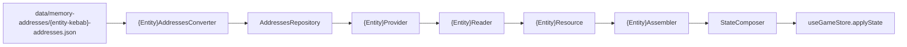

# Memory Entity Integration

Full pipeline for a **new** `State` entity. Reference implementation:
**`CardBattle`** (smallest end-to-end entity). For nested lists, mirror
**`Npcs`**.

**Prerequisite:** addresses confirmed (`memory-compare`) and the user agreed a
new entity is warranted (not a field on an existing one). Confirm the entity
name before starting: `{Entity}` (PascalCase, classes and types), `{entity}`
(camelCase, `State` property) and `{entity-kebab}` (file names).

## When NOT to use

| Case | Use instead |
|------|-------------|
| New field on Player / Party / DigimonBattle / … | `memory-field-integration` |
| New quest or journal category | `journal-quest-integration` |

## Pipeline

## Checklist

Paths under `App/src/memory/` unless stated otherwise. Mirror each
`card-battle*` file.

### 1. Definitions + addresses

- [ ] `data/memory-addresses/{entity-kebab}-addresses.json` (or a subfolder such as `battles/`, `parties/`)
- [ ] `addresses/{entity-kebab}.addresses.ts` — `{Entity}AddressesRaw` (PascalCase keys, `AddressValueRaw`) and `{Entity}Addresses` (camelCase, `number`)
- [ ] `converters/{entity-kebab}-addresses.converter.ts` — `{Entity}AddressesConverter.convert(raw)` with `AddressValueConverter`
- [ ] `repositories/addresses.repository.ts` — JSON import, `private static` cache field and `get{Entity}Addresses()` through `load(fileName, convert)`

### 2. Read + assemble

- [ ] `resources/{entity-kebab}.resource.ts` — raw `number`s, no domain rules
- [ ] `readers/{entity-kebab}.reader.ts` — `static read(snapshot, addresses)`, stateless
- [ ] `src/state/models/{entity-kebab}.ts` — domain model; export it in `src/state/models/index.ts`
- [ ] `assemblers/{entity-kebab}.assembler.ts` — `static assemble(resource)`, pure, sentinel rules from `.cursor/rules/digivice-business.mdc`
- [ ] `providers/{entity-kebab}.provider.ts` — `static get(snapshot)`: repository → reader → assembler

### 3. State

- [ ] `src/state/models/state.ts` — `{entity}: {Entity}`
- [ ] `state.composer.ts` — `{entity}: {Entity}Provider.get(snapshot)`
- [ ] Lists inside the entity → key per list property in `ListKeys` (`patch/state.patcher.ts`); list items need a stable key (`id`, `index`, …)
- [ ] **SKIP** `useGameStore`, `GameLoop` and `StatePatcher` logic — they work on the whole `State`

### 4. Tests

Conventions: skill `frontend-memory-tests`.

- [ ] `tests/memory/readers/{entity-kebab}.reader.spec.ts` — synthetic (`FakeSnapshotBuilder`) and real definitions
- [ ] `tests/memory/assemblers/{entity-kebab}.assembler.spec.ts` — sentinel cases
- [ ] `tests/memory/providers/{entity-kebab}.provider.spec.ts` — real `.bin` fixture
- [ ] `tests/memory/repositories/addresses.repository.spec.ts` — the new file in "should load every addresses file"
- [ ] `tests/fixtures/snapshots/*.expected.ts` — the entity in each expected `State` (values confirmed with the user against the game); the composer spec fails until then
- [ ] Lists → case in `tests/memory/patch/state.patcher.spec.ts`
- [ ] `npx vitest run`

### 5. UI (only when the user asks)

Components read through `useGameState()`; derived information in
`state/stores/selectors/`, composition with static data in presenters.

### 6. Docs

- [ ] Add the entity row to the entity map in `.cursor/skills/memory-field-integration/SKILL.md`
- [ ] Product rules of the entity in `.cursor/rules/digivice-business.mdc`
- [ ] Retrofeed `.cursor/skills/memory-compare/memory-regions.md` when it came from an investigation
