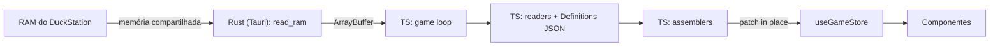

# Plano de migração — leitura de memória em TS (Tauri + Rust mínimo)

Documento de continuidade do planejamento. Registra o diagnóstico, as decisões tomadas, a arquitetura alvo, a lista de mudanças e as etapas.

## Status

| Etapa | Descrição | Status |
|---|---|---|
| 1 | Fundação de testes | Concluída |
| 2 | Rust: conexão e `read_ram` | Concluída |
| 3 | Snapshot e definitions | Concluída |
| 4 | Fatia vertical: Player | Concluída |
| 5a | ImportantItems, Auctions, CardBattle | Concluída |
| 5b | Npcs | Concluída |
| 5c | DigimonBattle | Concluída |
| 5d | Journal | Concluída |
| 5e | Party | Concluída |
| 6 | Patch in-place e troca da fonte | Concluída |
| 7 | Produção sem sidecar | Concluída |
| 8 | Fechamento de docs | Concluída |

**Migração concluída.** O Digivice é uma única aplicação Tauri: o Rust só lê a RAM (`read_ram`) e toda a lógica fica na camada de memória TS (`Frontend/src/memory/`). O C# está congelado no repositório, só como referência.

## Contexto e motivação

Hoje o Digivice são duas aplicações:

- **Backend C# (.NET):** sidecar subido pelo Tauri. Lê a RAM do DuckStation a cada 500ms, monta o `State`, calcula diffs e envia eventos via SignalR.
- **Frontend Vue:** recebe os eventos, converte e sincroniza na `useGameStore`. A "mágica" (informação derivada, presenters, UI) acontece aqui.

A ideia: **uma única aplicação**. O Tauri já é o processo host; a UI Vue roda numa webview que não acessa memória de outros processos, então o Rust faz **apenas** a leitura bruta da RAM. Todo o resto (readers, assemblers, game loop, escrita na store) passa para TypeScript, na mesma camada da UI. Sem eventos, SignalR, porta ou sidecar.

O motivo **não** é abandonar o C#; é eliminar a separação em duas aplicações e a duplicação de contrato (DTOs C# ↔ TS, differs ↔ syncers).

## Decisões tomadas

1. **Arquitetura:** Tauri + Rust mínimo + lógica em TS. Electron e sidecar em Node/Bun foram descartados.
2. **Leitura:** o Rust devolve a RAM inteira (2 MB) por tick como binário. Os readers TS usam `DataView` sobre o snapshot.
3. **Diff:** a reatividade do Vue substitui o diff. O loop faz patch in-place na store (primitivo igual não dispara reatividade).
4. **Testes:** a nova camada de leitura (readers, assemblers, definitions, patch da store) **terá testes** (Vitest). O restante do frontend continua sem testes.
5. **Tools:** tudo em `Tools/` deve continuar funcionando **sem alterações**.
6. **Definitions:** a cópia em `Frontend/src/memory/definitions/` é a **oficial** (parser equivalente ao `HexOrIntStringToIntConverter`). A cópia em `Backend/Memory/Definitions/` fica congelada com o C# (não é mais sincronizada) e continua no lugar porque o `MemoryScanner` lê o `MainQuestAddresses.json` dela. O teste de paridade entre as duas existiu da etapa 3 à 7 e foi apagado na etapa 8. Ver "Pendências para a remoção do backend".
7. **C# congelado no repositório** (`Backend/`, `Tests/`, `Digivice.slnx`): fica só como referência, para conferir algum comportamento antigo, e como lado sombra do modo `compare`. Não é deletado nem atualizado.
8. **Projeto pausado durante a migração** (encerrado na etapa 8): nada novo foi adicionado até a migração estar completa, aprovada e funcional. A partir daqui funcionalidade nova volta a ser implementada, só no TS.
9. **Comparação permanente em dev:** após a troca da fonte, o caminho SignalR no frontend fica como modo `compare` só para desenvolvimento, por tempo indeterminado. O C# nunca volta para a build de produção.
10. **Docs progressivos:** cada etapa atualiza as regras, skills e docs que ela muda. Etapa só é concluída com docs atualizados.
11. **Etapas revisáveis:** migração em partes, cada uma revisada antes da próxima.
12. **Pasta da camada nova:** `Frontend/src/memory/` (espelha `Backend/Memory/`). Sufixos `.reader.ts`, `.assembler.ts`, `.provider.ts`.
13. **Testes:** Vitest, ambiente `node`, em `Frontend/tests/` espelhando `src/`, arquivos `*.spec.ts` 1:1 com produção. Regra `digivice-frontend-tests.mdc`, skill `frontend-memory-tests`.
14. **Fixtures `.bin`:** versionadas no git em `Frontend/tests/fixtures/snapshots/`, poucas e catalogadas no README da pasta. Geradas pelo `MemoryScanner snapshot`.

## Desenvolvimento local

- Fluxo diário: `npm run tauri:dev` (script já existe). Sobe o Vite com HMR e abre a janela do Tauri apontando para ele (`devUrl`).
- Só a casca Rust é compilada (debug, incremental, em cache). Frontend é servido ao vivo, sem build e sem empacotamento.
- DevTools: botão direito → Inspect / `Ctrl+Shift+I` na janela do Tauri. Vue DevTools via `vite-plugin-vue-devtools` (hoje comentado no `vite.config.ts`).
- `npm run dev` no navegador puro só funciona com o provedor de snapshot por arquivo (`.bin`).
- Modo `compare`: subir também o backend C# (`dotnet run`), como hoje. O proxy `/gamehub` do Vite funciona dentro da janela do Tauri.

## Arquitetura alvo

Em modo `compare` (dev), o pipeline SignalR atual alimenta um estado "sombra" e um comparador aponta divergências entre os dois `State`.

## Diagnóstico do estado atual (resumo)

**Backend:** `GameLoopService` → `StateComposer` → Providers → Loaders → Readers (Resources) → Assemblers (domínio) → `StateEventFactory` (Differs, `Optional<T>`) → `EventDispatcherService` (SignalR). Erro limpa o estado; recuperação reenvia `InitialState`.

**Frontend:** `SignalRService` → `signalr.handlers.ts` → `useGameStore` (`setInitialState` com converters, `sync{Entity}` com syncers) → `useGameState()`.

Pontos que motivam ou afetam a migração:

- Um campo novo toca cerca de 13 arquivos (JSON, Addresses, Reader, Resource, Assembler, Model, DTO, Converter, Differ + DTO, model, converter e syncer TS).
- Entidades com formato fixo no código (`Npcs` com 27 propriedades, `ImportantItems`), repetidas em todas as camadas.
- Leituras individuais ao longo do tick, sem snapshot consistente.
- Lógica de domínio em readers (`EnemyReader`, `StepReader`).
- Corrida rara: cliente conectando entre o envio do diff e o `UpdateState` pode receber `InitialState` antigo.
- Contrato C# ↔ TS espelhado à mão.

## Mudanças por área

### 1. Rust (Tauri)

- **Removido (etapa 7):** spawn do sidecar, porta livre, `get_backend_port`, evento `backend-crashed` em `Tauri/src/lib.rs`.
- **Novo:** achar o PID do DuckStation e abrir o mapping `duckstation_{pid}` (equivalente a `DuckstationConnector` + `WindowsMemoryProvider`). Crate `windows` (`OpenFileMappingW`/`MapViewOfFile`; processos via ToolHelp, sem `sysinfo`). Nome do processo (`duckstation-qt-x64-ReleaseLTCG`) vira constante.
- **Novo:** comando `read_ram` que copia a RAM e devolve binário, ou código de erro.
  - **Cuidado:** usar `tauri::ipc::Response` (binário). Serializar `Vec<u8>` como JSON vira um array de 2 milhões de números.
  - **Cuidado:** comando `async`. Comandos síncronos rodam na thread principal e podem travar a janela.
- **Cuidado — mapping "congelado":** com o handle aberto, o Windows mantém a memória viva mesmo após o DuckStation fechar. A leitura continuaria devolvendo RAM congelada, sem erro. Checagem de processo vivo a cada chamada pelo handle do processo (`WaitForSingleObject` com timeout 0), em vez de listar processos a cada tick como o `ProcessIdChanged` do C#.
- **Tamanho da RAM (decidido na etapa 2):** snapshot **fixo em 2 MiB**, mesmo com a opção de 8 MB do DuckStation (todos os endereços ficam abaixo de `0x200000`). Mesmo formato dos `.bin` do `MemoryScanner` e do `FakeSnapshotBuilder`. View menor que 2 MiB = `memory_read_failed`.
- **Códigos de erro mantidos:** `process_not_found`, `mapping_not_found`, `connection_failed`, `memory_read_failed`.
- **Capabilities (etapa 7):** remover `shell:allow-execute` do sidecar; manter `shell:allow-open` (usado por `external-link.service.ts`).

### 2. Camada de leitura em TS

- **Feito na etapa 3 — provedores de snapshot:** `TauriSnapshotProvider` (`invoke("read_ram")`) e `FileSnapshotProvider` (`fetch` de um `.bin` de 2 MiB, formato do `MemoryScanner snapshot`). Ambos devolvem `MemorySnapshot` ou lançam `EmulatorConnectionError` (`code`, `detail`).
- **Novo — readers puros sobre `MemorySnapshot`** (feito na etapa 3: `readByte`/`readByte(bitMask)`/`readInt16`/`readInt32`/`readBytes`, equivalente ao `IMemoryReader`).
  - **Cuidado — sinal e endianness:** `Int16` → `getInt16(addr, true)`, `Int32` → `getInt32(addr, true)`, byte → `getUint8`. Ler `Int16` sem sinal faria o sentinela `0xFFFF` (hoje `-1` → `null`) virar `65535`.
- **Definitions (feito na etapa 3):** `AddressesRepository` importa os JSONs de `Frontend/src/memory/definitions/` (`@/memory/definitions/...`). Parser para hex (`"0x48"`), decimal (`"20"`) e negativo (`"-4"` em `ActiveDigievolution`); valor inválido **lança** (o C# cai para `0`). Quests por pasta via `import.meta.glob`, ordenadas pelo nome do arquivo como no C#. O frontend não depende de nada fora de `Frontend/`.
- **Sem blocos de memória:** com o snapshot, tudo é endereço absoluto (base + offset). O bloco de 1500 bytes do Digimon deixa de existir.
- **Comportamentos de leitura a preservar exatamente:**
  - `StepReader`: sem máscara lê o byte; uma máscara aplica `&`; várias exigem todas ativas e o valor final usa a primeira.
  - `EnemyReader`: slot ativo = índice ativo válido com id → primeiro com id e HP > 0 → último com id → 0.
  - `InBattleReader`: índice do slot da party começa em 1 (`partySlotIndex - 1`).
  - `StoredDigievolutionReader`: até 60 entradas, para no primeiro id `<= 0`.
  - `PartyLoader`: só lê o Digimon se `DigimonId != EmptySlotId`.
  - Blast: endereço próprio por Digimon (`BlastAddress`).
- **Novo — assemblers** que devolvem os models já existentes em `Frontend/src/models`. Normalizações a portar:
  - `mapId`/`previousMapId` em hex com 4 dígitos (`X4`).
  - `seabedRoute` e `mapVariant`: `0` → `null`.
  - `activeDigievolutionId <= 0` → `null`.
  - Equipamentos `<= 0` → `null`.
  - Slot de digievolução: id `<= 0` → vazio; preenchido busca `level`/`dvexp` em `storedDigievolutions` (ausente → `level = 1`, `dvexp = 0`); `dvexp` negativo → `0`.
  - Inimigo com id `<= 0` → `enemy = null`.
  - Card battle com id `<= 0` → `null`.
  - Important items: `!= 0` → `true`.
  - Auctions: bit em `0x4B38A`.
  - NPCs: `won = value != 0`.
  - Cascade da main quest.
  - Normalização da Duel Island.

### 3. Game loop e health

- **Novo — loop TS:** `setTimeout` encadeado a cada 500ms (nunca sobrepor ticks): `read_ram` → readers → assemblers → patch.
- **Health:**
  - Somem: `sidecar-crashed` e `hub-unreachable` (`useAppHealthyScreen`).
  - Ficam: `loading` (antes do primeiro tick bem-sucedido), `operational-error` (códigos do Rust + `state_compose_failed` quando reader/assembler lança exceção) e `healthy`.
  - `config_missing` provavelmente some (nome do processo vira constante).
- **Cuidado — invariantes:** healthy implica estado presente; erro limpa `currentState` (UI desmonta); recuperação gera estado completo novo.
- **Cuidado — HMR:** cancelar o timer em `import.meta.hot.dispose`, senão cada hot reload cria mais um loop.
- **Cuidado — throttling:** com a janela minimizada, o WebView2 pode reduzir timers. Hoje não quebra nada (sem histórico entre leituras), mas precisa ser confirmado. Alternativa: o Rust conduz o loop e empurra o snapshot por evento.

### 4. Store (`useGameStore`)

- **Novo — patch in-place genérico,** campo a campo, com listas casadas por chave:
  - slots por `index`; digievoluções por `index`; `storedDigievolutions` por `digievolutionId`;
  - quests por `id`; steps por `number`; requisites por `id`; batalhas de NPC por `id`.
  - Transições objeto ↔ `null` (inimigo, Digimon do slot) substituem o objeto inteiro.
  - **Cuidado:** nunca substituir o `State` ou listas inteiras a cada tick (re-render total duas vezes por segundo).
- **Cuidado — regras que dependem do estado anterior** (hoje nos syncers; vão para o patch):
  - Slot de digievolução preenchido → vazio é ignorado, com `storeLogger.warn`.
  - `storedDigievolutions` só cresce (`push`).
  - Slot com Digimon trocado substitui o Digimon inteiro.
- Primeiro tick equivale ao `InitialState` (atribui o `State` completo).
- **Continua igual:** `currentState` anulável, 8 entidades nunca `null`, 3 slots fixos, `useGameState()`, selectors, presenters e componentes.

### 5. Frontend: o que deixa de ser o caminho principal

Mantido apenas para o modo `compare` (dev), por decisão 9:

- `events/` (`signalr.service`, `signalr.handlers`, `events.map`, `dto/`, `converters/`, `hub-connection-error`), `stores/syncers/`, actions `sync*`, proxy `/gamehub`, `AppConfig.backend`, `@microsoft/signalr`.

Removido do caminho de produção:

- `tauri-backend-process.listener`, `setBackendProcessFailed`, `syncHubConnectionStatus` e estados correspondentes, chaves i18n `sidecarCrashed`/`hubUnreachable`.
- `events/logger.ts` e os códigos de erro do emulador são reaproveitados (podem mudar de pasta).

### 6. Repositório e build

- **Mantidos:** `Backend/`, `Tests/` (xUnit), `Digivice.slnx` e `Tools/` inteiro.
- **Produção (etapa 7):** remover do `tauri.conf.json` `externalBin`, `resources` (appsettings, `Memory/`) e `beforeBundleCommand`; o script `Tauri/scripts/copy-sidecar-runtime.ps1` deixa de ser usado.
- `DebugConsoleRenderer` (`Features:Debugging`): substituto natural é o inspetor de Pinia do `vite-plugin-vue-devtools` ou um painel de debug.

### 7. Testes (nova camada TS)

- **Vitest** restrito à camada de leitura nova. Exceção explícita na regra "sem testes no frontend" (`digivice-frontend.mdc`).
- **Checklist de paridade:** cada `*ReaderTests`, `*AssemblerTests` e `AddressesRepositoryDefinitionsTests` do C# ganha equivalente TS. Testes de Differ, Converter, EventFactory e Hub não têm equivalente (camadas não existem no modelo novo).
- **Helper de snapshot falso:** monta um `ArrayBuffer` escrevendo `int16`/`int32`/byte em endereços. Substitui o mock de `IMemoryReader`.
- **Fixtures reais:** `.bin` do `MemoryScanner snapshot`.
- **Patch da store:** testes para as regras que dependem do estado anterior.

### 8. Tools

- Devem continuar funcionando **sem alteração** durante a migração.
- `Tools/MemoryScanner/Program.cs` (`FindMainQuestDefinitionsPath`) procura `Backend/Memory/Definitions/Quests/MainQuestAddresses.json` por caminho fixo → a cópia do backend não pode mudar de lugar enquanto existir. Quando o backend for apagado, a ferramenta precisa ser atualizada (ver "Pendências para a remoção do backend").
- `MemoryScanner snapshot <file.bin>` já gera o dump de 2 MiB que a camada TS consome (fixtures e modo navegador).
- `analyze_snapshots.py` e `Tools/Scripts/Spliting-images.py` não são afetados.

### 9. Docs, regras, skills e agents (progressivo)

Feito ao longo das etapas e fechado na etapa 8 (ver o registro da etapa 8):

- **Regras:** `digivice-backend.mdc` marcada como congelada; `digivice-tests.mdc` apagada; `digivice-frontend-sync.mdc`, `digivice-frontend.mdc`, `digivice-frontend-tests.mdc` e `digivice-business.mdc` descrevem o loop TS.
- **Skills:** `address-field-backend` + `address-field-frontend` → `memory-field-integration`; `memory-entity-backend` + `memory-entity-frontend` → `memory-entity-integration`; `quest-pattern-backend` + `quest-pattern-frontend` → `journal-quest-integration`; `backend-tests` apagada.
- **Ajustados:** agents `memory-investigator` e `docs-auditor`, skills `memory-compare`, `battle-memory-investigate`, `map-subzone-investigate` e `frontend-memory-tests`, docs de investigação e índices em `AI/*.md`.

### 10. Pendências para a remoção do backend

O C# não é apagado nesta migração (decisão 7). Quando for, no mesmo momento:

- **Atualizar `Tools/MemoryScanner/Program.cs` (`FindMainQuestDefinitionsPath`)** para procurar `Frontend/src/memory/definitions/Quests/MainQuestAddresses.json`, para a ferramenta continuar funcionando. Única exceção prevista à regra "Tools sem alteração", feita junto com a remoção.
- Remover o modo `compare` (SignalR, `useCSharpShadowStore`, `events/`, `stores/syncers/`, comparador, proxy `/gamehub`, `@microsoft/signalr`) e a regra `digivice-backend.mdc`.
- Revisar as referências restantes a `Backend/` e `Tests/` em regras, skills e agents.

## Comparação C# × TS

- Os dois lados produzem o mesmo tipo `State` (`@/models`): C# via `StateDTO` → converters existentes; TS via assemblers. Comparar = deep-compare dos dois `State`, reportando o caminho divergente (ex.: `party.slots[0].digimon.hp.current: C#=120, TS=118`).
- **Modo de execução** (via `VITE_MEMORY_MODE`): até a etapa 5, `csharp` (padrão) | `compare` com o TS na sombra; a partir da etapa 6, `typescript` (padrão) | `compare` com o C# na sombra.
- **Timing:** os dois leem em momentos diferentes; campos voláteis divergem por um instante. Mitigações:
  - DuckStation **pausado**: RAM parada, tudo tem que bater 100%.
  - Com o jogo rodando: só reportar divergências que persistam por N ticks seguidos.
- **Produção:** mantém o sidecar até a etapa 6/7; depois sai do bundle. O C# fica no repositório.

## Critério de "pronto" de cada etapa

- Testes passando.
- Comparador sem divergências na(s) entidade(s) da etapa, com o emulador pausado em cenários variados (campo, batalha, card battle, quests em pontos diferentes).
- Docs, regras e skills afetados atualizados.
- Revisão e aprovação antes da próxima etapa.

## Etapas

1. **Fundação de testes:** Vitest restrito à camada nova, convenção de local/nome dos testes, helper de snapshot falso, uso dos `.bin` como fixtures, exceção na regra de testes.
2. **Rust:** conexão, `read_ram`, códigos de erro, checagem de processo vivo. Convive com o sidecar; nada consome ainda.
3. **Snapshot e definitions:** provedores (Tauri e arquivo `.bin`), cópia dos JSONs de definitions para o frontend, parser e testes de integridade e de paridade das definitions.
4. **Fatia vertical do Player:** reader, assembler, testes, game loop TS em modo sombra, health básico e comparador. Prova a arquitetura inteira.
5. **Demais entidades, em subetapas (simples → complexa):** cada uma com plano, testes, validação em `compare` e commit próprios; entra no `StateComposer` e no comparador.
   - **5a:** ImportantItems, Auctions, CardBattle.
   - **5b:** Npcs (lista de batalhas na ordem do JSON).
   - **5c:** DigimonBattle (inimigo + heurística do slot ativo). Fixture nova: batalha com vários inimigos.
   - **5d:** Journal (steps/requisitos com várias bitmasks, cascade da main quest, regras da Duel Island).
   - **5e:** Party (Kotemon é o id `0`, id desconhecido = slot vazio, cruzamento com digievoluções guardadas). O `MemoryBlockReader` não ganha equivalente: os offsets reais ficam abaixo dos 1500 bytes do bloco, então a leitura absoluta no snapshot dá o mesmo resultado.
   - Fixtures novas são geradas na subetapa que precisar delas.
   - Divergências do comparador vindas das regras dos syncers da Party (slot de digievolução preenchido → vazio ignorado; `storedDigievolutions` só cresce) são analisadas caso a caso; o tratamento é da etapa 6.
6. **Patch in-place e troca da fonte:** regras dependentes do estado anterior, com testes. A store principal passa a ser alimentada pelo TS; o C# vira o lado sombra.
7. **Produção sem sidecar:** `lib.rs`, `tauri.conf.json`, capabilities. SignalR fica só no modo `compare`.
8. **Fechamento de docs:** revisão final de regras, skills, agents e índices (o grosso já foi feito em cada etapa).

## Registro das etapas

### Etapa 1 — Fundação de testes (concluída)

- Vitest 5 (compatível com o Vite 7) com scripts `npm run test` (watch) e `npm run test:run`.
- `Frontend/vitest.config.ts` herda `vite.config.ts`; inclui apenas `tests/**/*.spec.ts`; ambiente `node`.
- `Frontend/tsconfig.vitest.json` (referenciado no `tsconfig.json`) faz o `npm run type-check` cobrir `tests/`.
- Helpers em `Frontend/tests/helpers/`: `FakeSnapshotBuilder` (snapshot sintético little-endian, aceita negativos, valida limites e faixas) e `SnapshotFixtureLoader` (carrega `.bin` de 2 MiB), com testes.
- `Frontend/tests/fixtures/snapshots/README.md` com geração e catálogo (ainda sem fixtures; as primeiras entram na etapa 4).
- `PlayStationRamSize` vivia em `tests/helpers/snapshot.constant.ts`; subiu para `src/memory/snapshot/` na etapa 3.
- Docs: `digivice-frontend.mdc` (escopo de testes e sufixos), nova `digivice-frontend-tests.mdc`, nova skill `frontend-memory-tests`, `digivice-tests.mdc`/`backend-tests` marcados como legado, `AI/CODE_RULES.md` e `docs-auditor` atualizados.

### Etapa 2 — Rust: conexão e `read_ram` (concluída)

- Crate `windows` 0.61 (mesma versão já usada pelo Tauri). Módulo `Tauri/src/memory/` (`process`, `mapping`, `handle`, `session`, `error`) e comando `read_ram` em `Tauri/src/commands.rs`, registrado no `lib.rs` com `MemoryState`. Sidecar inalterado.
- `read_ram` (`async`): confere processo vivo, conecta/reconecta, copia 2 MiB e devolve binário (`tauri::ipc::Response`). Erros `{ code, detail }`: `process_not_found`, `mapping_not_found`, `connection_failed`, `memory_read_failed`. Qualquer erro descarta a sessão.
- Paridade de erros com o C#: qualquer falha ao abrir/mapear a memória compartilhada vira `mapping_not_found` (como o `WindowsMemoryProvider`); falha ao listar/abrir o processo vira `connection_failed`.
- Sem `cargo test` (decisão): validação manual no DevTools **da janela do Tauri** (`npm run tauri:dev`, `Ctrl+Shift+I`). No navegador comum não existe a ponte com o Rust.
- Docs: nova regra `digivice-tauri.mdc`, linha em `AI/CODE_RULES.md`.
- **Validação manual (aprovada):**
  - `read_ram` devolve 2097152 bytes; o byte em `0x4B3F8` bate com o mapa atual do jogo.
  - Tempo por chamada: 21–27 ms (build debug, 5 chamadas seguidas). O custo é a transferência pela IPC, não a cópia; folga ampla no tick de 500 ms.
  - DuckStation fechado → `process_not_found`. Exportação de memória compartilhada desligada → `mapping_not_found`. Fechar e reabrir o DuckStation reconecta sozinho, sem reiniciar o Tauri.
  - UI atual (C# via SignalR) continua funcionando em paralelo.
- **Observação para a etapa 4:** com a exportação ligada, o DuckStation cria a memória compartilhada ao abrir, mesmo **sem jogo carregado**; o `read_ram` conecta e devolve a RAM (quase toda zerada). O C# tem o mesmo comportamento (paridade), mas o health TS precisa considerar o caso "conectado sem jogo". Decidido na etapa 4: manter a paridade, sem tratamento especial.

### Etapa 3 — Snapshot e definitions (concluída)

- `Frontend/src/memory/` criado, espelhando `Backend/Memory/`:
  - `snapshot/`: `MemorySnapshot`, `SnapshotProvider`, `TauriSnapshotProvider`, `FileSnapshotProvider`, `MemoryReadError`, `EmulatorConnectionError`, `PlayStationRamSize`.
  - `addresses/`: tipos de endereço de todos os 30 JSONs (tipo final camelCase + `...Raw` PascalCase no mesmo arquivo). `NpcsAddresses` derivado das chaves do model `Npcs` (29 NPCs).
  - `converters/`: `AddressValueConverter` + um converter por arquivo de definitions.
  - `repositories/addresses.repository.ts`: mesmos métodos do `AddressesRepository` C#, cache lazy.
  - `definitions/`: cópia dos 30 JSONs de `Backend/Memory/Definitions/` (mesmos nomes e pastas; formatados pelo Prettier com 2 espaços). Fonte do TS.
- Config: nenhuma dependência fora de `Frontend/` (sem alias extra, sem `server.fs.allow`). Build de produção embute os JSONs no bundle.
- Decisões: todos os JSONs nesta etapa; definitions copiadas para o frontend (o backend será apagado no futuro), com teste de paridade enquanto as duas cópias existirem; valor inválido ou campo escalar ausente **lança** ao carregar (divergência intencional do C#; listas ausentes continuam `[]`); o provedor por arquivo recebe a URL no construtor; a escolha do provedor (e a variável `VITE_MEMORY_SNAPSHOT_URL`) fica para a etapa 4.
- Testes portados: `MemoryReaderTests`, os 3 testes de conversores e `AddressesRepositoryDefinitionsTests` (+ ordem das quests). Mais specs dos providers com `invoke`/`fetch` simulados e o teste de paridade das definitions (mesmo conjunto de arquivos e mesmo conteúdo interpretado). Total: 116 testes.
- Docs: `digivice-frontend.mdc` (estrutura de `src/memory/`, sufixos, terceiro contexto de converters), `digivice-frontend-tests.mdc` e skill `frontend-memory-tests` (mocks, checklist de paridade com status), `digivice-backend.mdc` (cópia das definitions no frontend), skills/agents de investigação apontando para a cópia do frontend.

### Etapa 4 — Fatia vertical do Player (concluída)

- Leitura do Player em `Frontend/src/memory/`: `resources/player.resource.ts`, `readers/player.reader.ts`, `assemblers/player.assembler.ts` (hex `X4` com `& 0xffff`, `0` → `null`), `providers/player.provider.ts` (substitui Loader + Provider do C#) e `state.composer.ts` (`ComposedState = Pick<State, "player">`, cresce por etapa; `pick` recorta o `State` do C# para comparar).
- Loop em `src/memory/loop/`: `GameLoop` (`setTimeout` encadeado de 500 ms, sem sobreposição, leitura em andamento descartada no `stop`), `SnapshotProviderFactory` (`VITE_MEMORY_SNAPSHOT_URL` → arquivo; senão Tauri → `read_ram`; senão nada) e `initializeMemoryLoop` (no `main.ts`, para o loop no `import.meta.hot.dispose`).
- Health sombra equivalente ao `HealthEventFactory`: `Loading` até o primeiro sucesso, `Healthy` com estado, `Error` limpa o estado e guarda código e detalhe. Emulador aberto sem jogo: sem tratamento especial (paridade com o C#; tratar seria funcionalidade nova).
- Ativação: `VITE_MEMORY_MODE=compare` (padrão `csharp`, loop desligado), em `Frontend/.env.development.local`. Estado em `useMemoryShadowStore` (nenhum componente lê).
- Comparador: `StateComparator` (deep-compare com caminho) + `DivergenceTracker` (reporta após 3 leituras seguidas e avisa a resolução). A cada leitura do TS compara `health.status`/`health.errorCode` e `state` (entidades migradas; um lado `null` e o outro não = divergência em `state`). Saída no console (`[Compare]`); health do TS logado em `[Memory]` quando muda.
- Primeira fixture real: `field-central-park.bin` (catalogada).
- Testes: porte de `PlayerReaderTests`, `PlayerLoaderTests`, `PlayerAssemblerTests` e `PlayerProviderTests` (+ `-1` → `"FFFF"`, sentinelas), provider e composer sobre a fixture, `GameLoop` com timers falsos, comparator, tracker e factory. Total: 166 testes.
- Verificação automática: em dev com `VITE_MEMORY_MODE=compare` e a fixture, o loop lê o `.bin` a cada 500 ms, health TS `Healthy`, sem erros e sem divergências contra o C# conectado ao DuckStation pausado no mesmo ponto da fixture.
- Docs: `digivice-frontend.mdc` (camadas, sufixos, variáveis `VITE_MEMORY_*`), `digivice-frontend-tests.mdc` (escopo), skill `frontend-memory-tests` (formatos de teste por camada, checklist).
- **Validação manual (aprovada)** (Tauri + DuckStation, `VITE_MEMORY_MODE=compare`, sem `VITE_MEMORY_SNAPSHOT_URL`):
  - Emulador pausado em mapas variados: sem divergências.
  - Jogo rodando e trocando de mapa: sem divergências persistentes.
  - Fechar o DuckStation: os dois lados em `Error`/`process_not_found`; reabrir: os dois se recuperam.
  - Sem a variável: app igual ao atual, sem logs `[Memory]`.
  - Não feita: checagem opcional de divergência proposital (`VITE_MEMORY_SNAPSHOT_URL` com o jogo em outro mapa). Risco baixo: o reporte de divergências é coberto pelos testes do comparator e do tracker.

### Etapa 5a — ImportantItems, Auctions e CardBattle (concluída)

- Mesmo molde do Player em `Frontend/src/memory/` (resource, reader, assembler, provider por entidade):
  - ImportantItems: 4 x `readByte`; `!= 0` → `true`.
  - Auctions: 6 x `readByte(address, bitMask)` no byte `0x4B38A`; `!= 0` → `true`.
  - CardBattle: `readInt32`; `<= 0` → `null`.
- `ComposedState` passa a `Pick<State, "player" | "importantItems" | "auctions" | "cardBattle">`; `compose` e `pick` com as quatro entidades. Comparador e initializer sem mudança.
- Testes: porte de `ReaderTests`, `LoaderTests`, `AssemblerTests` e `ProviderTests` das três entidades, mais bordas (`0xFF`, bits fora das máscaras, `-1`/`0`/`1`, `Int32` com sinal) e a fixture do Central Park (Tree Boots e Fishing Pole; Divine Barrier, Hazard Shield e Dramon Shield consumidos; CardBattle `-1` → `null`). Total: 197 testes.
- **Validação manual (aprovada):** modo `compare` no Tauri com o DuckStation, sem divergências nem logs inesperados.

### Etapa 5b — Npcs (concluída)

- `Frontend/src/memory/`: `resources/npcs.resource.ts` (`NpcsResource = Record<keyof Npcs, NpcResource>`), `readers/npcs.reader.ts`, `assemblers/npcs.assembler.ts`, `providers/npcs.provider.ts`; `npcs` no `ComposedState`, `compose` e `pick`.
- Decisão: reader e assembler percorrem os NPCs de forma genérica pelas chaves dos endereços (o C# lista os 29 à mão); o teste do repositório garante os 29 NPCs com batalhas.
- Batalhas via `Object.entries(npc.battles)`: mantém a ordem do JSON porque as chaves (`first`, `second`) não são numéricas. `won = value !== 0`.
- Valores esperados da fixture do Central Park centralizados em `tests/fixtures/snapshots/field-central-park.expected.ts` (`ComposedState`), usados pelos specs do composer, do loop e dos providers.
- Testes: porte de `NpcsReaderTests`, `NpcsLoaderTests`, `NpcsAssemblerTests` e `NpcsProviderTests`, mais ordem `first`/`second`, NPC sem batalhas e endereço fora do snapshot. Total: 210 testes.
- **Validação manual (aprovada):** modo `compare` no Tauri com o DuckStation, sem divergências; NPCs vencidos conferidos no jogo.

### Etapa 5c — DigimonBattle (concluída)

- `Frontend/src/memory/`: `resources/parties/digimons/vital.resource.ts`, `resources/battles/enemy.resource.ts`, `resources/digimon-battle.resource.ts`, `readers/enemy.reader.ts`, `readers/digimon-battle.reader.ts`, `assemblers/digimon-battle.assembler.ts`, `providers/digimon-battle.provider.ts`; `digimonBattle` no `ComposedState`, `compose` e `pick`.
- `EnemyReader` replica a heurística do C# para o slot ativo: índice ativo válido com id `!= 0`; senão, primeiro slot com id `!= 0` e HP atual `> 0`; senão, último slot com id `!= 0`; senão, slot `0`. `groupId` é global (fora do slot).
- Assembler: `enemy.id <= 0` → `enemy = null`; `field = 0` é o campo neutro.
- Fixture nova `battle-against-natsumi.bin` (catalogada, com `battle-against-natsumi.expected.ts`): slot ativo 1, Vegiemon (id 25) HP 192/192, `groupId` 201, conferido com o relato do jogo. Central Park: `digimonBattle = { field: 0, enemy: null }`.
- Força, defesa e velocidade do inimigo são deltas de buff/debuff (`+0x10..+0x14` do slot), não atributos absolutos; na fixture de batalha leem `0` porque nenhum Digimon da Natsumi aplica buffs.
- Testes: porte de `EnemyReaderTests` (10 casos), `DigimonBattleReaderTests`, `DigimonBattleLoaderTests`, `DigimonBattleAssemblerTests` e `DigimonBattleProviderTests`, mais bordas (`groupId` global, `Int16` com sinal, ids `0`/`-1`/`-0x8000`, endereço fora do snapshot) e as duas fixtures. Total: 237 testes.
- **Validação manual (aprovada):** modo `compare` no Tauri com o DuckStation em batalha contra NPC; atualizações do inimigo corretas, sem divergências.

### Etapa 5d — Journal (concluída)

- `Frontend/src/memory/`: resources (`journals/quests/requisite`, `journals/quests/step`, `journals/quest`, `journal`), `addresses/journal.addresses.ts` (montado pelo provider com os getters do repositório), `readers/quest.reader.ts`, `readers/journal.reader.ts`, assemblers (`quest`, `main-quest`, `duel-island`, `journal`) e `providers/journal.provider.ts`; `journal` no `ComposedState`, `compose` e `pick`.
- Decisão: um único `QuestReader` lê requisitos e steps, com uma só função de valor (o C# duplica a lógica em `StepReader` e `RequisiteReader`). Paridade: sem máscara = byte inteiro; uma máscara = `byte & máscara`; várias = `0` se faltar algum bit, senão `byte & máscaras[0]`.
- Assemblers não mutam: o cascade da main quest (todo step antes do último feito vira feito) e as regras da Duel Island (requisito pendente zera os steps; troféu feito marca os anteriores) geram objetos novos.
- Fixtures: as duas têm o mesmo journal. Main quest 1–61 (na RAM os steps 6 e 21 estão desligados; o cascade os completa). Expected montado com helpers (`quest`, `questIn`, `stepsUntil`) sobre as definições, com só os steps e requisitos feitos listados.
- DRI agents Kotemon, Patamon e Renamon têm só o step 3 feito na RAM: é o estado normal dos Digimons da party inicial (qualquer DRI agent fica assim quando o Digimon é escolhido no início do jogo). Sem cascade, como no C#.
- Testes: porte de `RequisiteReaderTests`, `StepReaderTests`, `QuestReaderTests`, `QuestLoaderTests`, `JournalLoaderTests`, assemblers (`Requisite`, `Step`, `Quest`, `MainQuest`, `DuelIsland`, `Journal`) e `JournalProviderTests`, mais bordas (bits fora das máscaras, requisito de step fora do snapshot, cascade com buracos, Duel Island sem steps, não mutação do resource, RAM vazia). Total: 289 testes.
- **Validação manual (aprovada):** modo `compare` no Tauri com o DuckStation avançando a side quest do DRI agent Veemon; steps marcando normalmente, sem divergências nem logs inesperados.

### Etapa 5e — Party (concluída)

- `Frontend/src/memory/`: resources (`parties/digimons/{attributes,elements,equipments,digievolution-slot,stored-digievolution,in-battle}`, `parties/digimon`, `parties/digimon-slot`, `party`), `addresses/party-memory.addresses.ts` (party, digimons, status e inBattle, montado pelo provider com os getters do repositório), `readers/{in-battle,digimon,party}.reader.ts`, `assemblers/{digimon,party}.assembler.ts` e `providers/party.provider.ts`; `party` no `ComposedState`, `compose` e `pick` (as 8 entidades do `State` agora vêm do TS).
- Decisões:
  - Sem `MemoryBlockReader`: o Digimon é lido de forma absoluta em `memoryBlockAddress + offset` (offsets reais abaixo de 1500; `activeDigievolution` em `-4`). Endereço fora do snapshot lança erro em vez de devolver `null`.
  - `PartyReader` concentra a lógica dos loaders: id `0xFF` ou ausente dos endereços → `digimon null` (Kotemon é o id `0`); o resource guarda o id cru e o assembler transforma o slot sem Digimon em `digimonId null`.
  - Digievoluções guardadas: a partir de `0x50`, passo 20, até 60 entradas, parando no primeiro id `<= 0`.
  - `InBattle` do slot N em `0xA4470 + (N - 1) × 0x20`.
  - Assembler: `activeDigievolutionId` e equipamentos `<= 0` → `null`; slot de digievolução com id `<= 0` → vazio, senão cruza com as guardadas (ausente → level 1 e DVEXP 0; DVEXP negativo → `0`); guardadas sem DVEXP.
- Fixtures: Central Park com Kotemon (24, Kyukimon ativa), Patamon (20, Digitamamon ativa) e Renamon (20, Kabuterimon ativa), `inBattle` zerado; batalha contra a Natsumi só com Kotemon (`inBattle` HP 1989/2003) e slots 2 e 3 vazios. Expected com helpers (`digievolutionSlot`, `stored`, `OutOfBattle`) e o Kotemon do Central Park reaproveitado com sobrescritas.
- Divergências esperadas no modo `compare` (tratadas na Etapa 6, porque o C# as resolve no syncer e não na leitura): slot de digievolução preenchido → vazio (o syncer do C# ignora) e `storedDigievolutions` que só cresce.
- Testes: porte de `InBattleReaderTests`, `DigimonReaderTests`, `DigievolutionSlotReaderTests`, `StoredDigievolutionReaderTests`, `DigimonSlotReaderTests`, `PartyReaderTests`, `DigimonLoaderTests`, `PartyLoaderTests`, assemblers (`Digimon`, `DigievolutionSlot`, `StoredDigievolution`, `DigimonSlot`, `Party`) e `PartyProviderTests`, mais bordas (id desconhecido, Kotemon id `0`, lista de guardadas com lixo após entrada vazia, DVEXP `Int32` mínimo, slot 3 de batalha, endereço fora do snapshot, não compartilhamento de objetos) e as duas fixtures. Total: 345 testes.
- **Validação manual (aprovada):** modo `compare` no Tauri com o DuckStation; party conferida no jogo, sem divergências inesperadas.

### Etapa 6 — Patch in-place e troca da fonte (concluída)

- `Frontend/src/memory/patch/state.patcher.ts`: `StatePatcher` genérico (decisão em aberto fechada: patch genérico, não por entidade).
  - Primitivo só é atribuído se mudou; objeto ↔ `null` atribui o valor inteiro; objeto ↔ objeto desce campo a campo.
  - Listas casadas por chave pelo nome da propriedade (`ListKeys`): `slots`/`digievolutions` → `index`, `storedDigievolutions` → `digievolutionId`, quests/`requisites`/`battles` → `id`, `steps` → `number`. Item novo → `push`; ausente → removido.
  - Regras dos syncers do C#: slot de digievolução preenchido → vazio ignorado (`storeLogger.warn` uma vez por transição, não a cada tick); `storedDigievolutions` só cresce; `digimonId` diferente no slot substitui o Digimon inteiro.
- `useGameStore` passa a ser só do TS: `currentState`, saúde e `applyState` (primeiro tick ou recuperação atribui o `State` completo e recria o patcher; depois, patch) / `applyError` (limpa o estado).
- `useCSharpShadowStore`: o pipeline SignalR antigo (converters, syncers, `setInitialState`, `sync*`, saúde e status do hub), alimentado só no `compare`. `useMemoryShadowStore` removida.
- `initializeMemoryLoop`: modos `typescript` (padrão) e `compare`; o loop sempre sobe; no `compare` também inicia o SignalR e compara `useGameStore` (TS, já patcheado) com a sombra do C#. `main.ts` só chama o initializer. Sem provedor (navegador sem `VITE_MEMORY_SNAPSHOT_URL`): warn e tela em `Loading`.
- `StateComposer.compose` devolve `State`; `ComposedState` e `pick` removidos.
- Tela de saúde: só `loading` e `operational-error`. Removidos `sidecar-crashed`, `hub-unreachable`, `tauri-backend-process.listener.ts` e as chaves i18n `sidecarCrashed`/`hubUnreachable`. O sidecar ainda é empacotado e iniciado pelo Tauri até a Etapa 7, mas ninguém o consome fora do `compare`.
- Testes: `state.patcher.spec.ts` (referências preservadas, primitivo igual sem escrita, inimigo aparecendo/saindo/ficando, listas fora de ordem, itens novos e removidos, as três regras, aviso único e reaviso após preencher ou trocar o Digimon, Central Park → party da batalha) e `tests/stores/use-game-store.spec.ts` (primeiro tick, patch, erro, recuperação). Total: 367 testes.
- Docs: `digivice-business.mdc` (arquitetura), `digivice-frontend-sync.mdc` (reescrita), `digivice-frontend.mdc`, `digivice-frontend-tests.mdc`, skill `frontend-memory-tests`. As skills `address-field-frontend` e `memory-entity-frontend` ainda descrevem o caminho SignalR; reescrita na Etapa 8 (nada novo é adicionado durante a migração).
- **Validação manual (aprovada):** Tauri com o DuckStation; UI alimentada só pelo loop TS, dados conferidos no jogo, sem problemas.

### Etapa 7 — Produção sem sidecar (concluída)

- `Tauri/src/lib.rs`: só plugin shell (`open` dos links externos), `MemoryState` e `read_ram`. Removidos spawn do sidecar, porta livre, `get_backend_port`, evento `backend-crashed` e o kill do processo ao fechar a janela.
- `Tauri/tauri.conf.json`: sem `externalBin`, `resources` (appsettings, `Memory/`) e `beforeBundleCommand`. Capabilities: só `core:default` e `shell:allow-open`. `Tauri/.gitignore` sem `/binaries/`; a pasta local `Tauri/binaries/` (backend publicado) pode ser apagada à mão.
- Scripts: `Tauri/scripts/copy-sidecar-runtime.ps1` apagado; `build_app.ps1` enxuto (só `npm install` + `npx tauri build`, sem `dotnet publish`).
- Frontend: `signalr.service.ts` conecta sempre pelo proxy `/gamehub` do Vite (sem `get_backend_port` nem fallback de porta); `AppConfig.backend` só com `hubPath`; `VITE_MEMORY_MODE=compare` fora de dev gera warn e cai para `typescript`.
- C# continua no repositório (`Backend/`, `Tests/`, `Digivice.slnx`) e `Tools/` intocado; o backend só roda à mão (`dotnet run`) para o `compare` em dev.
- Verificação: `cargo build` sem warnings; type-check, 367 testes, build e eslint dos arquivos alterados ok.
- **Validação manual (aprovada):** app sem o processo do backend, lendo o jogo normalmente.

### Etapa 8 — Fechamento de docs (concluída)

- Decisões: o C# fica congelado (não apagado) para consulta; definitions do frontend passam a ser as oficiais e o teste de paridade sai; skills que perderam sentido são apagadas e as demais atualizadas; o modo `compare` só ganha documentação (campos novos aparecem como divergência `C#=undefined`, esperado).
- Código: `Frontend/tests/memory/definitions/definitions-parity.spec.ts` apagado. Total: 336 testes.
- Skills novas, só para a camada TS:
  - `memory-field-integration` — campo novo em entidade existente (mapa de entidades, tipos de leitura, checklist até testes e fixtures).
  - `memory-entity-integration` — entidade nova no `State` (molde `CardBattle`).
  - `journal-quest-integration` — quest em categoria existente ou categoria nova, das definitions à UI do Journal (`workflow-new-category.md`, `pipeline.md`, `status.md` unindo os status do backend e do frontend).
- Apagadas: skills `address-field-backend`, `address-field-frontend`, `memory-entity-backend`, `memory-entity-frontend`, `quest-pattern-backend`, `quest-pattern-frontend`, `backend-tests` e a regra `digivice-tests.mdc`.
- Atualizadas: regras `digivice-backend.mdc` (aviso de congelamento), `digivice-business.mdc`, `digivice-frontend.mdc`, `digivice-frontend-sync.mdc` e `digivice-frontend-tests.mdc`; skills `frontend-memory-tests`, `memory-compare` (+ `patterns-map.md`), `battle-memory-investigate` e `map-subzone-investigate`; agents `memory-investigator` e `docs-auditor` (C# fora do escopo da auditoria); docs de investigação; `AI/CODE_RULES.md` e `AI/BUSINESS_RULES.md`.

## Decisões em aberto

- Confirmar suporte de configuração de background throttling do Tauri no WebView2.
